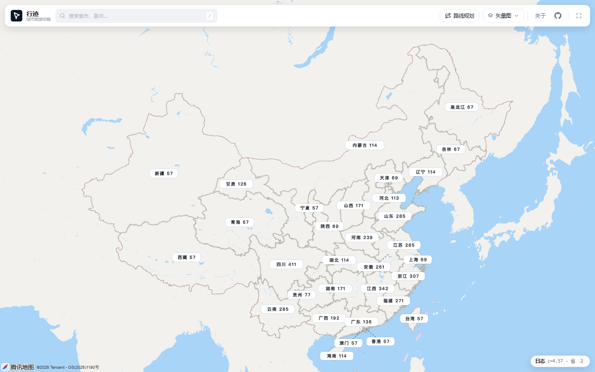
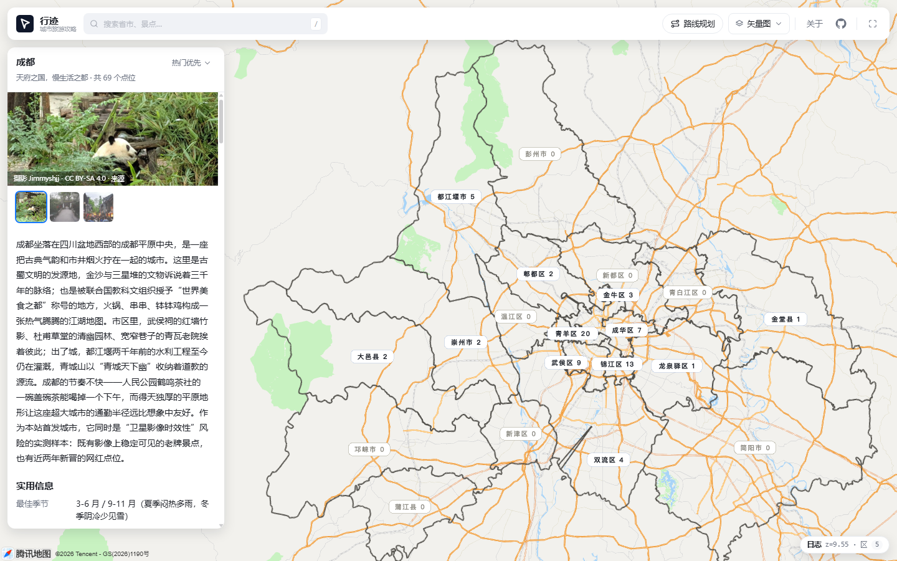

# 行迹 · 城市旅游攻略

**一张可以从全国一路钻到单个景点的旅游地图。**

底图铺满整个视口，所有界面都是浮在地图上的卡片 —— 不用在列表和地图之间来回切换，
想看哪一层直接点进去。

纯静态站点：没有后端，也没有服务端渲染。**地址栏始终是同一个 `/`** —— 井到哪一层都存在浏览器会话里，
刷新、后退都正常，不会因为点了几下就多出一串路径。



## 能做什么

| | |
|---|---|
| **四级下钻** | 全国 → 省 → 市 → 区 → 景点。区级徽标上直接写收录了几个点；还没收录的区标「待收录」，不会假装是 0 |
| **行程规划** | 把景点加进候选池、按天分组。顺序由你自己定 —— 这里没有「自动排最优路线」，旅行不是做 TSP |
| **路线规划** | 多段路线实时算时长与距离，驾车 / 公交 / 地铁 / 骑行 / 步行分别算 |
| **行程海报** | 一键把行程导成图片，含地图底图与图例。底图由同源函数代取，key 不进浏览器 |
| **数据驱动** | 新增一座城市 = 往 `data/` 放一个目录。索引、列表、图层全自动出现，前端零改动 |



## 快速开始

需要 Node ≥ 20.11、pnpm 12（`packageManager` 已锁版本，用错版本是部署失败的头号原因）。

```bash
git clone git@github.com:lin0306/travel_strategy.git
cd travel_strategy/web
pnpm install
cp .env.example .env.local     # 填 VITE_TMAP_KEY=你的key（腾讯位置服务，勾 JavaScript API GL）
pnpm dev                       # http://localhost:5173
```

不填 key 页面也能打开，只是地图加载不出来。

```bash
pnpm build       # 构建静态产物 → web/dist/client（发布根）
pnpm preview     # 本地看构建产物（与线上一致；dev 是未压缩的）
pnpm typecheck   # tsc --noEmit
pnpm check       # 工程自检，目标是 RESULT: ALL_CLEAN
```

## 部署（Netlify）

`netlify.toml` 已经写好（`base = web`、`publish = dist/client`、函数目录在 `web/netlify/functions`），
把仓库接上 Netlify 即可构建。控制台里还要配两个环境变量：

| 变量 | 前缀 | 用途 |
|---|---|---|
| `VITE_TMAP_KEY` | **必须有** `VITE_` | 浏览器端地图 SDK，会被编进 bundle |
| `AMAP_WEB_KEY` | **绝不能有** `VITE_` | 只给 `netlify/functions/staticmap.mjs` 取海报底图。带了前缀就会被 Vite 在构建期替换进 JS，等于公开 |

再给腾讯的 key 配一次域名白名单（`*.netlify.app`）。这个 key 天生是公开的，防线是白名单而不是保密。
高德那边相反：Web 服务的 key **没有**域名白名单（那只属于 JS API），所以海报底图走同源函数代理，
域校验在函数里做（`ALLOWED_ORIGINS`）。

发布根写错会全站 404，而本地 `pnpm preview` 根本不读 `netlify.toml`，看不出来 —— 细节见 [`AGENTS.md`](AGENTS.md) 第 3 节。

## 项目结构

```
data/        内容数据：城市、点位、区划、图片清单（唯一交接面）
web/         前端：Vite 7 · React 19 · TypeScript · React Router 7（SSG）
schema/      字段契约：schema.ts（Zod）↔ schema.py（Pydantic），同一份，改一边必须改另一边
pipeline/    采集流水线（Python）：图商取点 → 采编 → 抓图 → 组装
tools/       工程工具：自检、数据体检、图片审查、巡检
```

一条边界贯穿全仓：**抓取不 import 展示，展示不 import 抓取**，两边只通过 `data/` 交接。

> 仓库里只有代码、数据、部署三样东西。设计决策与操作手册属于维护者的过程资产，
> 放在本地不入库（`.gitignore` 里已注明）。

## 数据与图片来源

- 景点信息由采集流水线抓取后逐条复核，每条都带来源与更新时间
- 图片只收开放许可（以 Wikimedia Commons 为主），**每张都带作者与许可标识**，署名数据在 `data/credits/`
- 行政边界来自持牌图商，不使用第三方 GeoJSON
- 不采集、不上传任何位置信息；住宿点只存在你自己的浏览器的 localStorage 里

## 想加一座城市

1. 建目录 `data/cities/<省拼音>/<市拼音>/`，放 `city.json` 和 `pois/<大类>/<点位id>.json`（字段契约见 `schema/`）
2. `cd web && pnpm build` —— 数据聚合、路由、索引都会自动跟上
3. `pnpm check` 确认没有破坏工程约定

要连采集一起跑（取点、抓图、写文案），看 [`pipeline/README.md`](pipeline/README.md)。

## 参与开发

开工顺序、命令、红线、踩过的坑都在 [`AGENTS.md`](AGENTS.md) —— 它既是给 AI 协作者的开工说明，
也是这个仓库的工程约定。改代码前先读它。

## 许可

[Apache-2.0](LICENSE)。图片来源的署名与许可随图片数据一起分发，见 `data/credits/`。
